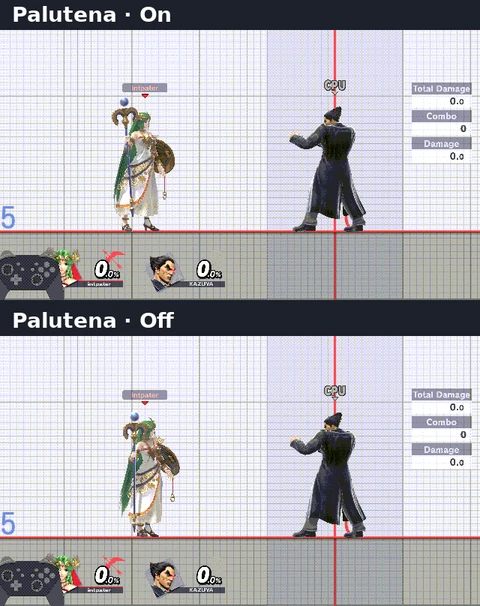
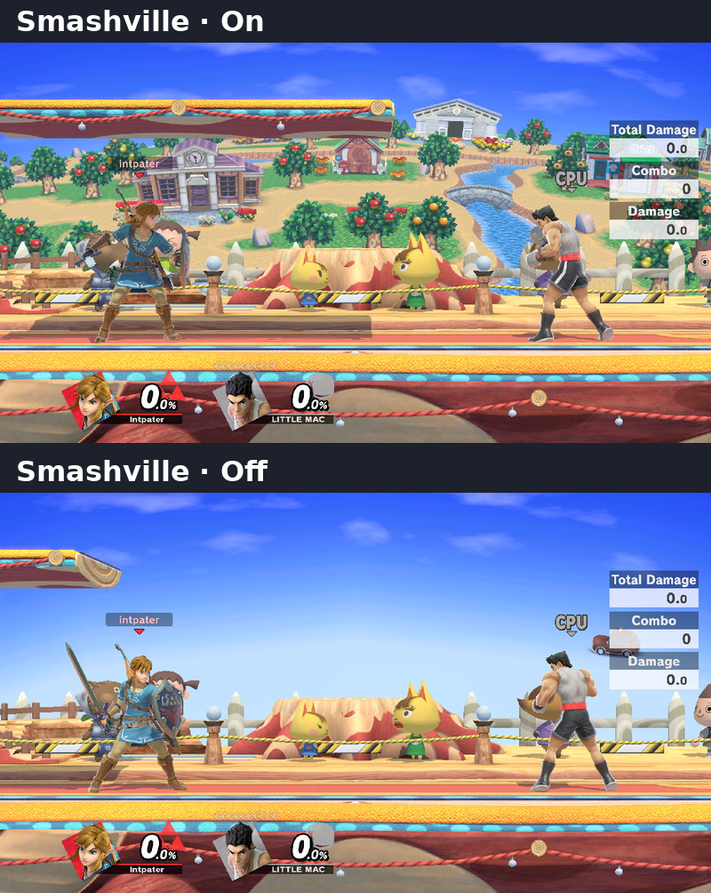

# ssbu-fx-control

> **Disclaimer:** this project was developed with the assistance of AI
> (Claude, Codex and other coding agents) under the operator's direction and
> review. Nothing is claimed beyond the dated tests cited in its docs.

A one-NRO Skyline plugin for **Super Smash Bros. Ultimate 13.0.5** that
turns down visual effects for ten fighters and eleven stages. It only changes
what is drawn: hitboxes, gameplay and the camera stay as they are.

**[Download 0.3.0](https://git.syntaxbyexample.com/intpa/ssbu-fx-control/releases/tag/v0.3.0)**

Tested in **Eden** only. No Switch test of 0.3.0 is recorded, and the plugin
was not installed on the test Switch as of 2026-11-12.
[Testing status](docs/MEDIA.md#testing-status)

## Fighter effects

*Palutena Autoreticle, On above Off. Eden, 2026-10-14, FX Control 0.1.0 (`eb627b8`). [Capture notes](docs/MEDIA.md#fighter-comparison)*

Each fighter is **On** (default), **Off** or **Reduced**. Reduced keeps the
cue that shows what a move does; a fighter without a variant offers On and
Off only. **Scope** defaults to **Online**; set it to **All** for offline
matches and Training. Variants are not yet proven to raise FPS.
[Fighters and variants](docs/FX.md)

## Stages

> **The Stages options aren't online-safe: use them offline only.** The plugin
> doesn't turn stage rows off for you online, so set them back to On
> (**All backgrounds** On) before you play online.

*Smashville On above Off. Eden, 2026-10-22, development build `39744aa9…` (before 0.3.0). [Media notes](docs/MEDIA.md#smashville-on-off-comparison)*

Each stage is **On** (default) or **Off**; there is no Reduced. Stage rows
ignore fighter Scope and All, so an Off row applies in every mode, online
included. Reload the stage after a change. Off hides selected background
effects and scenery, not the whole background, and no FPS gain is claimed.
[Stages](docs/STAGES.md)

## Controls

With [Online Deluxe](https://git.syntaxbyexample.com/intpa/ssbu-online-deluxe-rewrite)
0.5.6 or later (the pages work from 0.5.3):

1. Hold **L+R** and tap **D-pad Down** until **FX Control** or **Stages**
   appears.
2. **Up/Down** selects a row.
3. Hold **ZR** (not ZL) and press **Left/Right** to change it.

**All** sets every fighter row at once. [The pages](docs/MENU.md)

## Install

FX Control v0.3.0 (2026-10-24) is for players who want simpler backgrounds on eleven normal stages.

### What you need

| Thing | Upstream | Our fork | What the fork changes |
| --- | --- | --- | --- |
| Switch firmware | [23.0.1](https://en-americas-support.nintendo.com/app/answers/detail/a_id/22525) | — | — |
| Atmosphère | [1.12.1](https://github.com/Atmosphere-NX/Atmosphere/releases/latest) | [RO cleanup](https://git.syntaxbyexample.com/intpa/atmosphere-ro-cleanup-p1) | Cleans up after failed module loads. |
| Super Smash Bros. Ultimate | 13.0.5 | — | — |
| Skyline | [beta](https://github.com/skyline-dev/skyline/releases/latest) | [Skyline](https://git.syntaxbyexample.com/intpa/skyline) | Protects the logging queue during simultaneous writes. |
| Online Deluxe (for menu controls) | [0.5.3 or later](https://git.syntaxbyexample.com/intpa/ssbu-online-deluxe-rewrite/releases/latest) | — | — |

### Copy to the SD card

1. Close Smash. Download [libssbu_fx_control.nro](https://git.syntaxbyexample.com/intpa/ssbu-fx-control/releases/download/v0.3.0/libssbu_fx_control.nro).
2. Copy it to `sd:/atmosphere/contents/01006A800016E000/romfs/skyline/plugins/libssbu_fx_control.nro`. Create missing folders, then restart Smash.

Keep `manifest.json` on your computer for file verification.

**Update:** Replace the old NRO at that path. Keep `sd:/ultimate/ssbu_fx_control/config.ini` to retain settings.

**Uninstall:** Close Smash, delete `libssbu_fx_control.nro` from the plugins folder above, then restart Smash.

### What changed

| Change | Guide |
| --- | --- |
| Toggle backgrounds together or individually on Deluxe’s Stages page or in the INI. | [Details](https://git.syntaxbyexample.com/intpa/ssbu-fx-control/src/tag/v0.3.0/docs/STAGES.md) |
| Hide selected particles on five stages and scenery groups on six. | [Details](https://git.syntaxbyexample.com/intpa/ssbu-fx-control/src/tag/v0.3.0/docs/STAGE_TARGETS.md) |

### Tested on

| Feature | Hardware | Eden |
| --- | --- | --- |
| Toggle backgrounds together or individually on Deluxe’s Stages page or in the INI. | no | yes (candidate) |
| Hide selected particles on five stages and scenery groups on six. | no | yes (sampled candidate) |

“No” means no recorded test of that feature for this release.
The stage-specific checks used an Eden candidate. No hardware test of these controls is recorded.

### Known limits

- Use stage settings offline only. Set **All backgrounds** to **On** before playing online. Reload the stage after editing it. Some scenery stays visible. [Guide](https://git.syntaxbyexample.com/intpa/ssbu-fx-control/src/tag/v0.3.0/docs/STAGES.md)
- For INI-only play, edit `sd:/ultimate/ssbu_fx_control/config.ini` after first launch. Avoid Deluxe versions older than 0.5.0.

## More

[Stage targets](docs/STAGE_TARGETS.md) · [Measurement harness](docs/HARNESS.md) ·
[Performance records](docs/FX_PERFORMANCE_METHOD.md) · [Provenance](reference/README.md)

Build with `cargo skyline build --release` (or `tools/Build.ps1`); the NRO is
`target/aarch64-skyline-switch/release/libssbu_fx_control.nro`. Test with
`cargo test`.

License: MIT; see [LICENSE](LICENSE).
