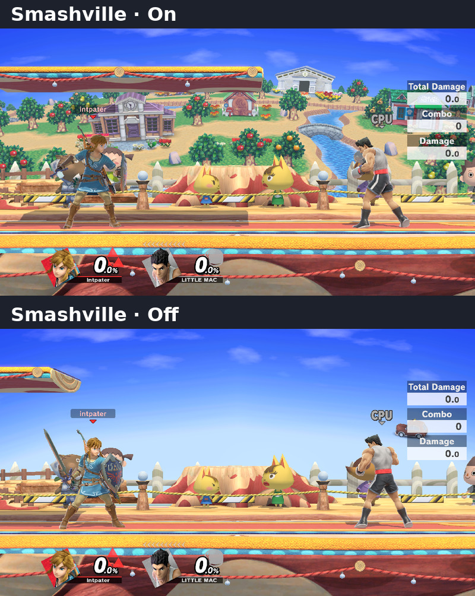

# ssbu-fx-control

> AI-assisted, human-directed and reviewed.

A one-NRO Skyline plugin for **Super Smash Bros. Ultimate 13.0.5** that
turns down visual effects for ten fighters and eleven stages. Gameplay,
hitboxes, camera and RNG are untouched.

**[Download 0.3.0](https://git.syntaxbyexample.com/intpa/ssbu-fx-control/releases/tag/v0.3.0)**

Tested in **Eden** and on an **Erista Switch** without issues observed, with
[firmware 23.0.1][firmware], [Atmosphère 1.12.1][atmosphere] and
[Skyline beta `2eb226f`][skyline] (checked 2026-10-25).
[Testing notes](docs/MEDIA.md)

## Fighter effects

*0.2.1 development capture, Scope All.*

Each fighter is **On** (default), **Off** or **Reduced**. Reduced keeps the
cue that shows what a move does; a fighter without a variant offers On and
Off only. **Scope** defaults to **Online**; set it to **All** for offline
matches and Training. Variants are not yet proven to raise FPS.
[Fighters and variants](docs/FX.md)

## Stages

*Separate On/Off development captures, 2026-10-22. [Media notes](docs/MEDIA.md#smashville-onoff-comparison)*

Each stage is **On** (default) or **Off**; there is no Reduced. Stage rows
apply online and offline, separately from fighter Scope and All. Reload the
stage after a change. Off hides selected background effects and scenery,
not the whole background, and no FPS gain is claimed.
[Stages](docs/STAGES.md)

## Controls

With [Online Deluxe](https://git.syntaxbyexample.com/intpa/ssbu-online-deluxe-rewrite)
0.5.6 or later (the pages work from 0.5.3):

1. Hold **L+R** and tap **D-pad Down** until **FX Control** or **Stages**
   appears.
2. **Up/Down** selects a row.
3. Hold **ZR** (not ZL) and press **Left/Right** to change it.

**All** sets every fighter row at once. [The pages](docs/MENU.md)

## Install

1. Copy `libssbu_fx_control.nro` to
   `sd:/atmosphere/contents/01006A800016E000/romfs/skyline/plugins/`,
   replacing any older copy, and restart the game.
2. Online Deluxe is optional. Without it, edit
   `sd:/ultimate/ssbu_fx_control/config.ini`, created on first start
   ([configuration](docs/CONFIGURATION.md)).
3. Don't pair it with Online Deluxe 0.4.x while that version's FX row is
   Off or Reduced.

## More

[Stage targets](docs/STAGE_TARGETS.md) · [Measurement harness](docs/HARNESS.md) ·
[Performance records](docs/FX_PERFORMANCE_METHOD.md) · [Provenance](reference/README.md)

Build with `tools/Build.ps1`; test with `cargo test`.

[firmware]: https://en-americas-support.nintendo.com/app/answers/detail/a_id/22525/~/nintendo-switch-system-updates-and-change-history#current
[atmosphere]: https://github.com/Atmosphere-NX/Atmosphere/releases/tag/1.12.1
[skyline]: https://github.com/skyline-dev/skyline/releases/tag/beta
