# ssbu-fx-control

> **Disclaimer:** this project was developed with the assistance of AI
> (Claude, Codex and other coding agents) under the operator's direction and
> review. Nothing is claimed beyond what is recorded in these documents.

A Skyline plugin for **Super Smash Bros. Ultimate 13.0.5**, delivered as **one
NRO**, that turns selected character effects **On**, **Off** or **Reduced**
for each covered fighter, with an **All** switch. It is the character-FX
feature of [Online Deluxe](https://git.syntaxbyexample.com/intpa/ssbu-online-deluxe-rewrite)
moved into its own plugin: the same request policy, tables and EFF siblings,
now per fighter.

- **On** (default) forwards every original request.
- **Off** substitutes the named `null` resource for the covered effects of
  that fighter, so the request path still runs.
- **Reduced** keeps a recognizable cue and removes surrounding decoration, or
  swaps in a lighter EFF sibling. Reduced never silently performs Off: a fighter
  without a Reduced variant is offered On / Off only.

Changes are visual request-path only. Gameplay articles, hitboxes, camera,
hitstop, RNG and simulation are never touched. Effects already on screen
finish normally; new requests follow the setting.

**Status:** version 0.1.0. The policy and its tables are the ones Online
Deluxe shipped and tested (see [FX runtime matrix](docs/FX_RUNTIME_MATRIX.md)).
This plugin was tested in Eden on 2026-10-14 next to Deluxe 0.5.0: the FX
Control page, the INI round trip and Sephiroth's Gigaflare under On, Off and
Reduced (GIFs below). **Not yet verified on a console.**

## Install

1. Copy `libssbu_fx_control.nro` to
   `sd:/atmosphere/contents/01006A800016E000/romfs/skyline/plugins/`.
2. [ARCropolis](https://github.com/Raytwo/ARCropolis) is needed for the
   Reduced **EFF siblings** (Palutena up air, Shadow Flare, Inkling roller,
   Chrom side B): the plugin registers ARCropolis load callbacks for those four
   `.eff` files. Without ARCropolis those cues stay original in Reduced (never
   Off); everything else works.
3. [Online Deluxe](https://git.syntaxbyexample.com/intpa/ssbu-online-deluxe-rewrite)
   is optional. With Deluxe 0.5.0 or later the plugin gets its own page in
   Deluxe's window and uses Deluxe's online tracking. Without Deluxe, edit the
   INI and the plugin tracks online play itself.

Settings live in `sd:/ultimate/ssbu_fx_control/config.ini`, created with the
defaults on first start (everything On, scope Online). See
[configuration](docs/CONFIGURATION.md).

Online Deluxe 0.5.0 dropped its built-in FX feature in favour of this plugin.
Do not run it next to an older Deluxe (0.4.x) with that FX row set to Off or
Reduced: both would filter the same requests, and both register ARCropolis
callbacks for the same four files.

## The Deluxe page

With Online Deluxe 0.5.0 or later, the plugin registers an own page titled
**FX Control** in Deluxe's window cycle (L+R or ZL+ZR, then D-pad Down):
settings, plugins, **FX Control**, performance, hidden. Up/Down selects a row,
Left/Right changes it. In a match the page becomes Deluxe's compact strip.

| Row | Choices | Notes |
| --- | --- | --- |
| Scope | Online / All | Online: online play outside Training. With a Deluxe older than 0.5.0 there is no online signal: the row reads `Unavailable` and Online never applies (effects stay original until `scope=all` is set in the INI). |
| All | On / Off / Reduced | Sets every fighter row. Shows `Unavailable` while the rows differ. |
| Kazuya ... Ganondorf | On / Off / Reduced | One row per covered fighter. On is green, Reduced yellow. |
| EFF variants | Ready / Pending / Unavailable | Read-only. Ready: a sibling file loaded. Pending: none loaded yet. Unavailable: ARCropolis missing or a file rejected. |

A Deluxe older than 0.5.0 refuses the registration (17 rows need descriptor
version 3); the plugin then works from the INI alone.

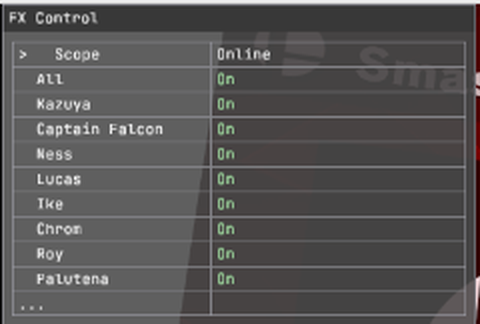

## Covered effects

One row per covered move. "Off removes" lists the named layers the Off table
nulls; "Reduced" lists what the keep/cull tables keep and cull, or the EFF
sibling it requests instead. Exact names are in
[`src/effects_catalog.rs`](src/effects_catalog.rs),
[`src/effects.rs`](src/effects.rs) and
[`src/effects_reduced_family.rs`](src/effects_reduced_family.rs).

| Fighter | Move | Off removes | Reduced | GIF |
| --- | --- | --- | --- | --- |
| Kazuya | Forward smash | Devil-fist arc, line, aura, electric, sign-flash, wing and named hit layers (`demon_*`), forward smash only | Keeps `demon_smash_line`, `demon_devil_aura`, `demon_devil_start`; culls `demon_devil_start_elec`, `demon_devil_sign_flash` | Forward smash, Eden 2026-10-14: 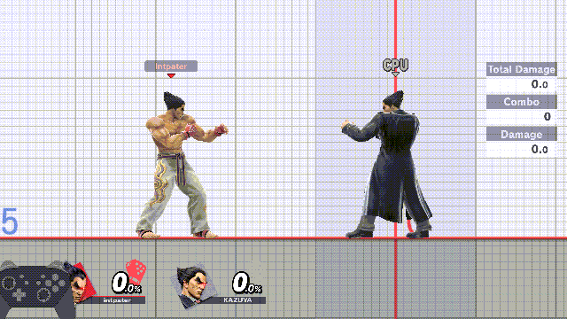 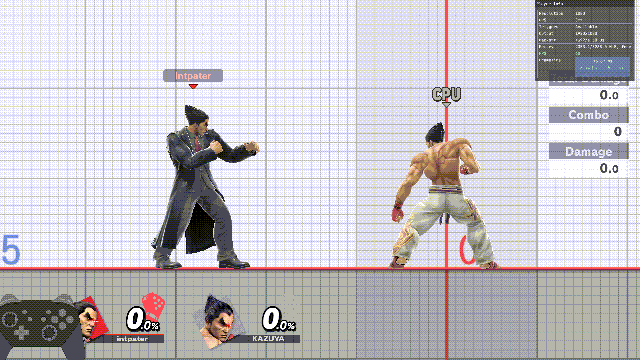 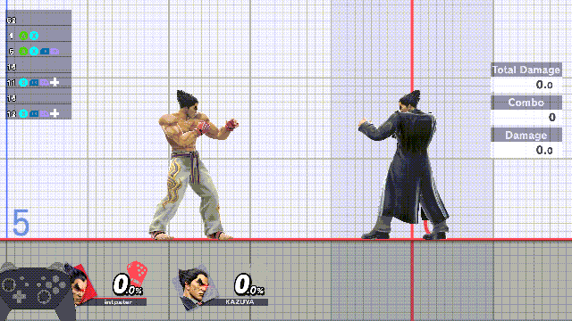 |
| Captain Falcon | Falcon Punch | Punch body, wings, flash, hit, hold and thrust layers (`captain_fp_*`, `captain_at_*`) | Keeps `captain_fp_body_l/r`, `captain_fp_hold`; culls `captain_fp_wing_l/r` | Falcon Punch, Eden 2026-10-14: 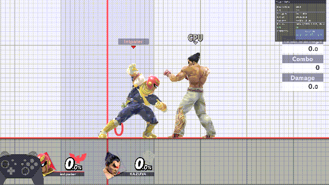 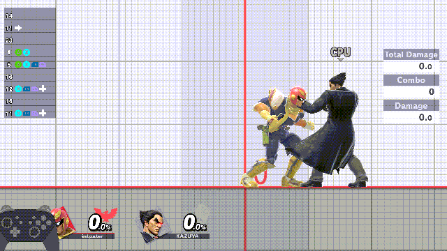 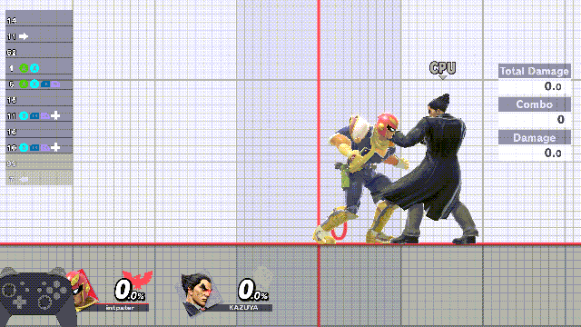 |
| Ness | PK Thunder (up special) | PK Thunder attack, bomb, hold, PSI and impact layers, `sys_flash` in that move | Keeps `ness_pkt_attack`; culls `ness_pkt_bomb` | PK Thunder, Eden 2026-10-14: 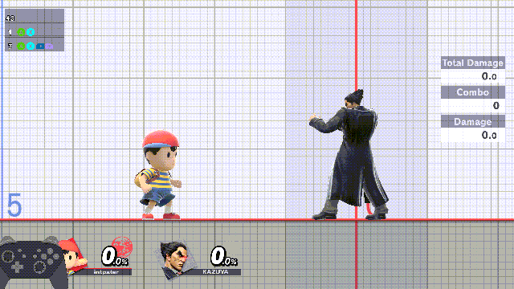 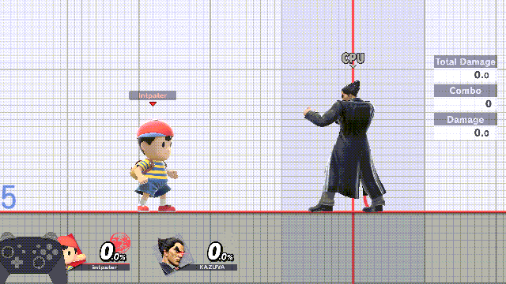 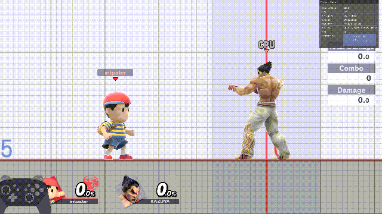 |
| Lucas | PK Thunder (up special) | PK Thunder attack, bomb, hold, PSI, flash and impact layers, `sys_flash` in that move | Keeps `lucas_pkt_attack`; culls `lucas_pkt_bomb` | PK Thunder, Eden 2026-10-14: 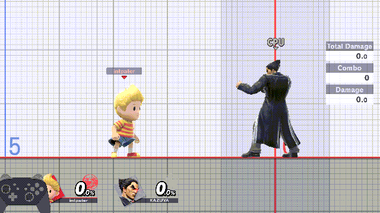 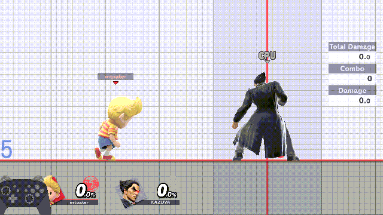 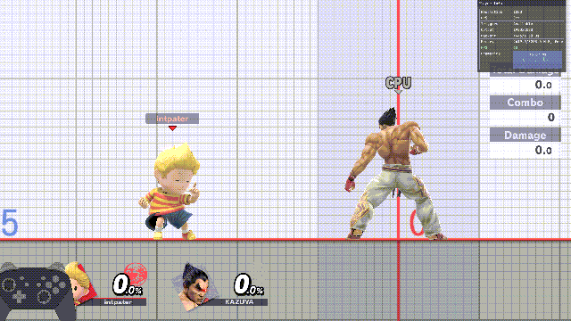 |
| Ike | Eruption (neutral special) | Volcano, flash, ground, pillar and sword layers (`ike_volcano*`, `P_IkeVolcano*`); also the character-wide `ike_sword`, `ike_iaigiri_hold` | Keeps `ike_volcano`, `ike_volcano_middle`, `ike_volcano_hold`; culls `ike_volcano_add`, `_add2` to `_add4` | Eruption, Eden 2026-10-14: 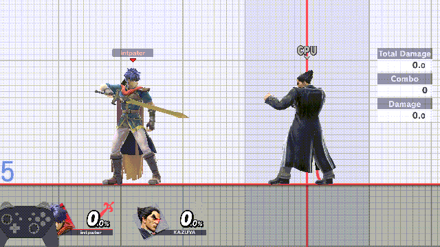 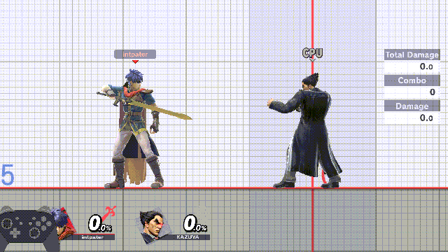 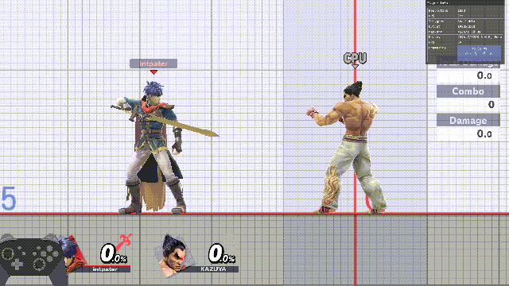 |
| Chrom | Flare Blade (neutral special) | Volcano, spark, flash, ring, lightning and purple-sword layers; also the character-wide `chrom_sword_aura`, `chrom_mc_aura*` names | Keeps `chrom_volcano_a/c/e`, `chrom_sword_purple`; culls `chrom_volcano_hold_2`, `chrom_volcano_spark` | Flare Blade, Eden 2026-10-14: 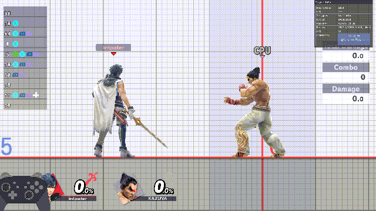 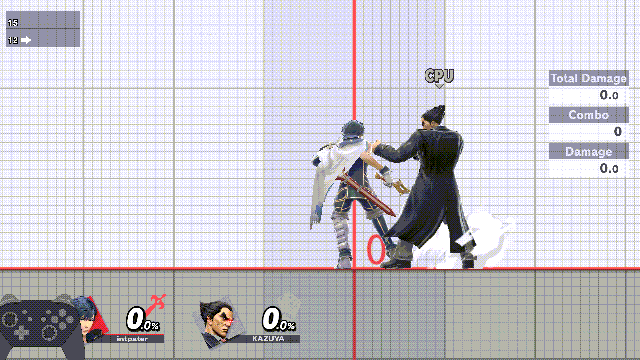 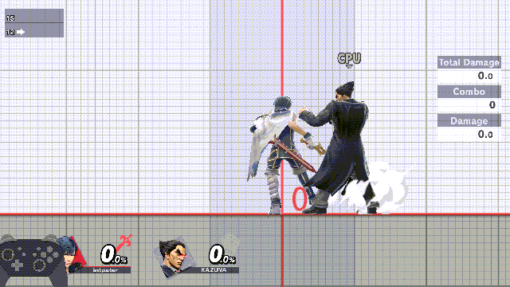 |
| Chrom | Double-Edge Dance, first trail | Not changed | EFF sibling `chrom_mc_1_reduced` (trail life 3 to 2) | Double-Edge Dance, Eden 2026-10-14: 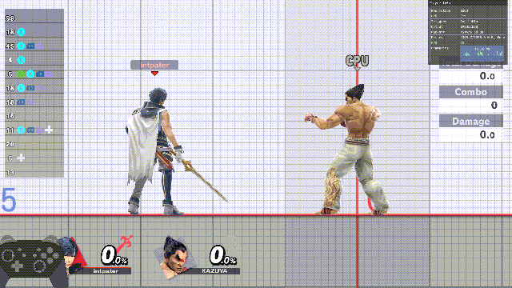  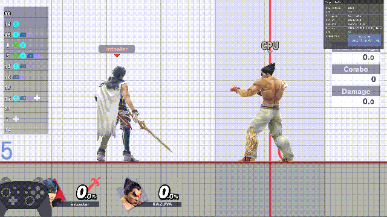 |
| Roy | Flare Blade (neutral special) | Eruption, bomb, fire, circle, lens, line and wind layers; also the character-wide `roy_sword`, `roy_fire`, `roy_mc_aura_*` | Keeps `roy_eruption_bomb_main`, `roy_eruption`, `_middle`, `_max`, `roy_erupution_hold`; culls `roy_eruption_bomb_start` and its `_middle/_high/_max` | Flare Blade, Eden 2026-10-14: 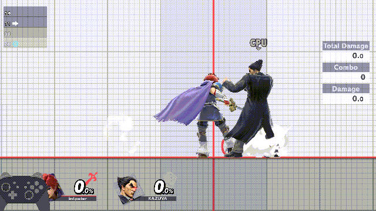 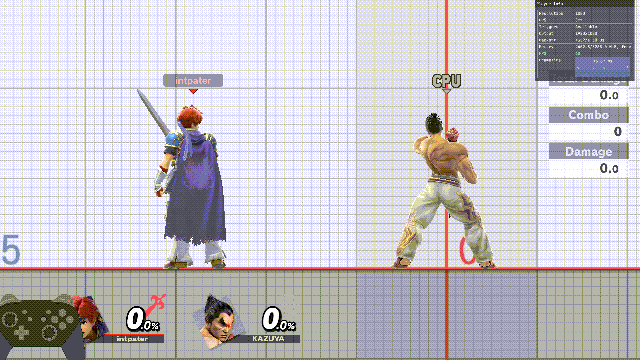 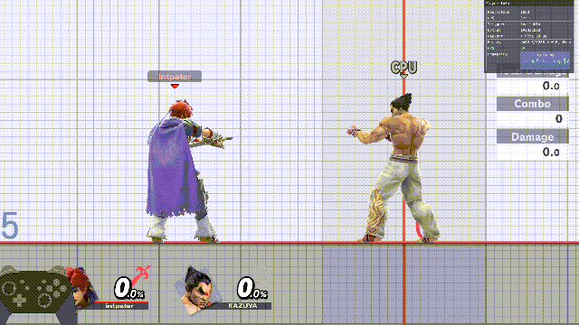 |
| Palutena | Rapid jab | Wand traces, lights, spark, finish, twinkle | Keeps `palutena_wand_spark`, `palutena_wand_finish`; culls `palutena_wand_light1` | Rapid jab, Eden 2026-10-14: 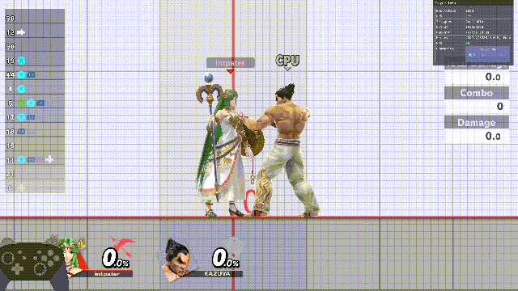 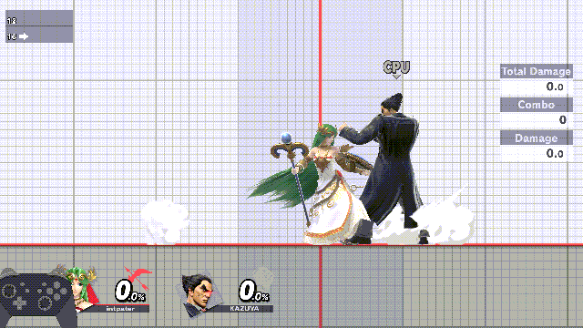 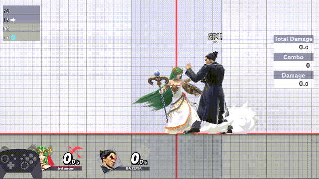 |
| Palutena | Autoreticle (neutral special) | Lock-on, sight, target, bullet, backlight and wand-light layers | Keeps `palutena_lockon`, `palutena_bullet_shot`; culls `palutena_wand_light_trace`, `palutena_wand_light2` | Autoreticle, Eden 2026-10-14: 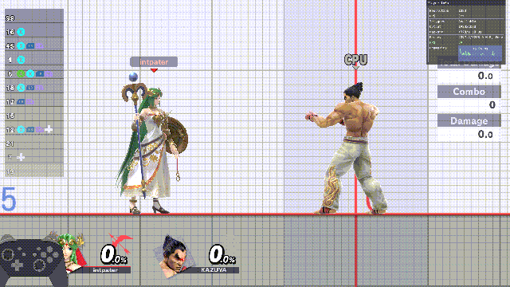 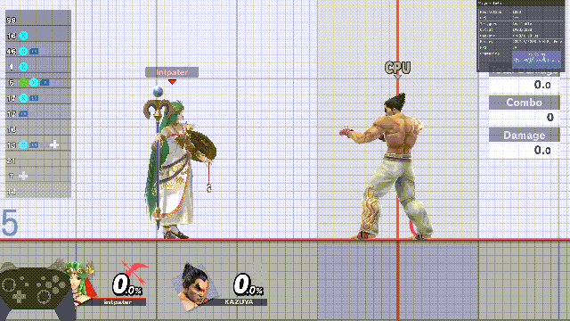 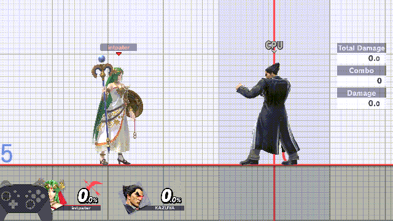 |
| Palutena | Explosive Flame (side special) | Bomb, appear, finish, bullet, pressure, fire and backlight layers | Keeps `palutena_bomb`, `palutena_bomb_finish`; culls `palutena_bomb_appear`, `palutena_wand_light_trace`, `palutena_wand_light2`, `palutena_backlight` | Explosive Flame, Eden 2026-10-14: 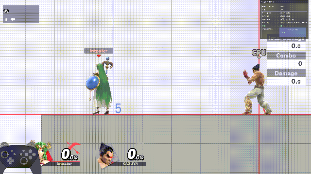 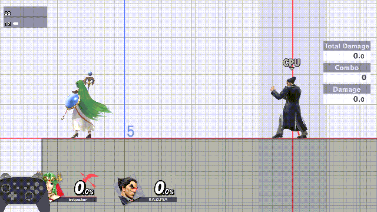 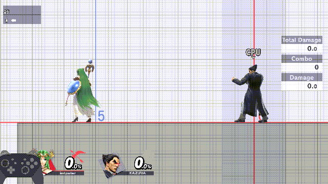 |
| Palutena | Warp (up special) | Teleport, escape, feather, gate and backlight layers | Keeps `palutena_teleport_start/end`; culls `palutena_backlight` | Warp, Eden 2026-10-14: 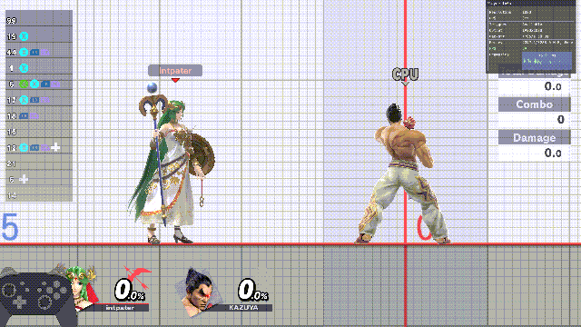 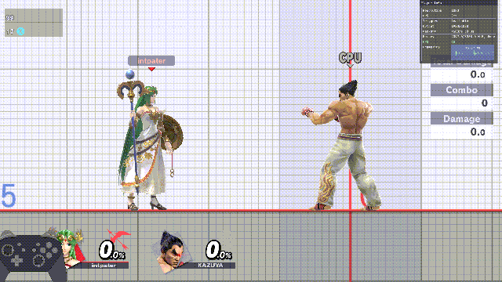 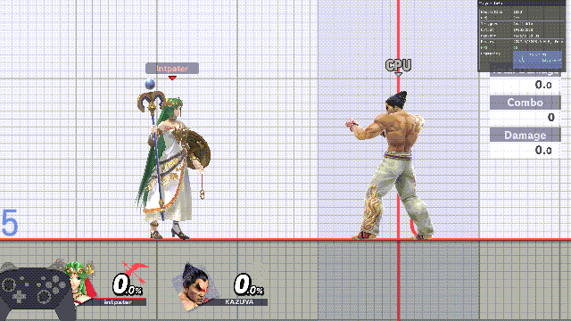 |
| Palutena | Tilts | Wand lights and spark | Keeps `palutena_wand_light4`, `palutena_wand_trace_01`; culls `palutena_wand_trace_08` | Tilts, Eden 2026-10-14: 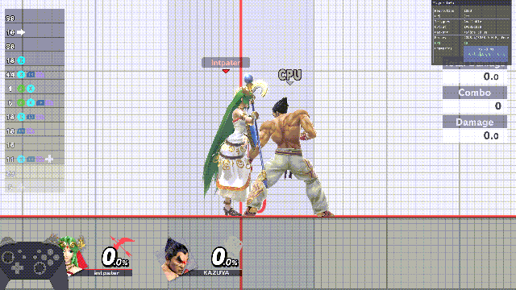 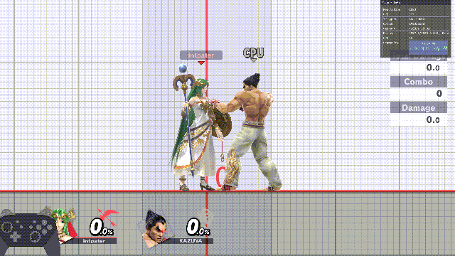 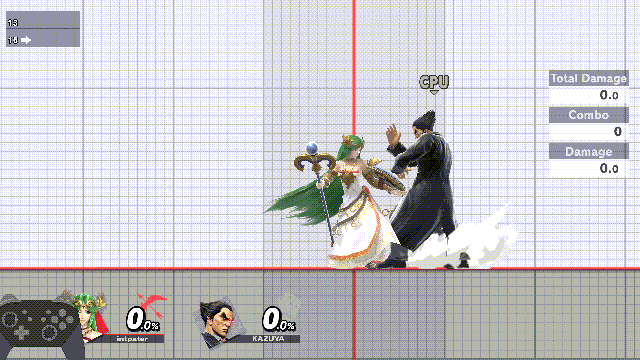 |
| Palutena | Up smash | Backlight, twinkle, lightning, meteor | Keeps `palutena_pressure`, `palutena_wand_light2`; culls `palutena_backlight` | Up smash, Eden 2026-10-14: 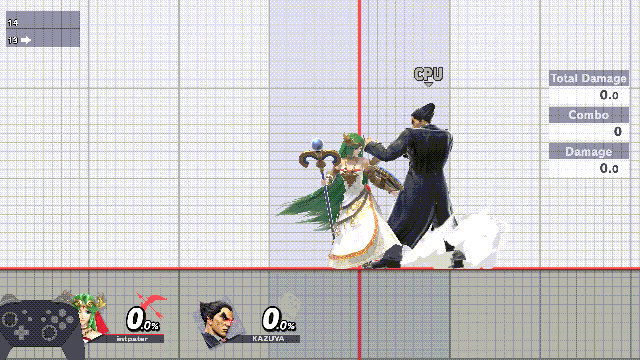 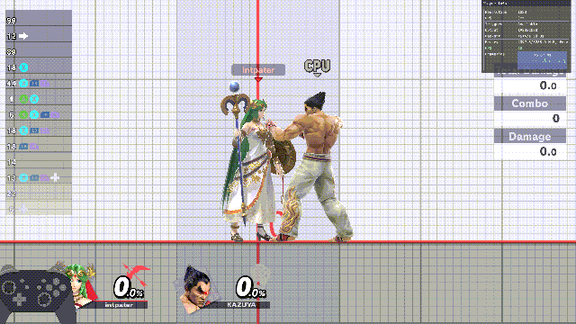 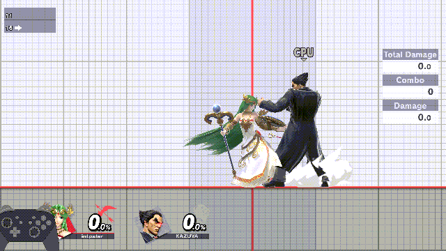 |
| Palutena | Forward and down smash | Wing feather layers | Keeps `palutena_feather`; culls `palutena_backlight` | Forward and down smash, Eden 2026-10-14: 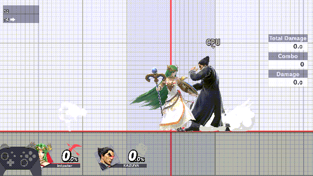 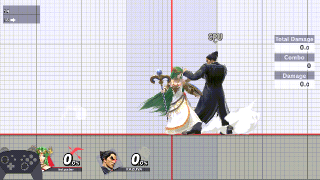 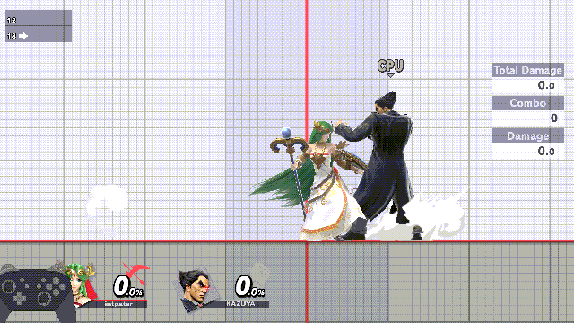 |
| Palutena | Up air | Feather, twinkle and backlight layers; the `palutena_backlight2` marker is protected and stays | EFF sibling `palutena_backlight2_reduced` (two emitters kept) | Up air, Eden 2026-10-14: 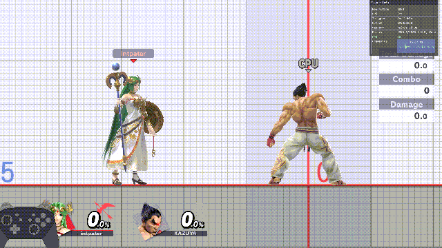 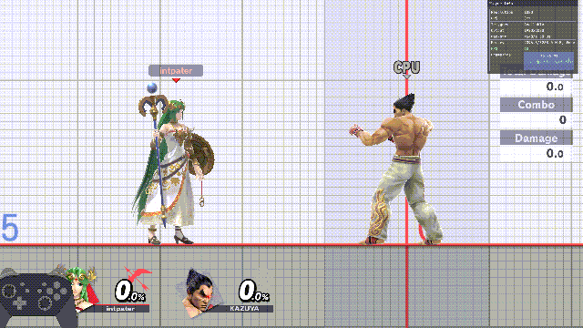 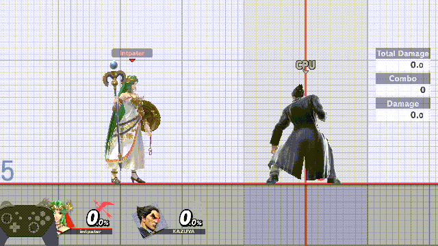 |
| Sephiroth | Flare / Megaflare / Gigaflare (neutral special) | Burst, smoke, fire, ring and spark layers; the Gigaflare screen overlay (`edge_fire3_screen2`) is skipped | Keeps `edge_fire3_burst2`, `edge_fire2_burst2`, `edge_fire1_burst`; culls `edge_fire3_burst`, `edge_fire2_burst`, `edge_fire1_sign`; overlay skipped | Gigaflare, Eden 2026-10-14: 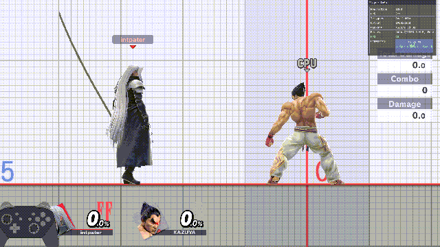 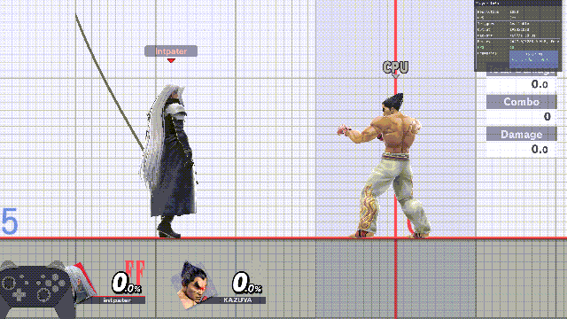  |
| Sephiroth | Shadow Flare (side special) | Every `edge_shadowflare_*` layer | EFF siblings for start, hold, beam, beam hit, bullet, bullet end, bullet attack and bullet hit (aura stays original) | Shadow Flare, Eden 2026-10-14:    |
| Sephiroth | Scintilla (down special) | Senkou start, hold, attack, end and flare/line layers | Keeps `edge_senkou_shield`, `edge_senkou_hold_attack`; culls `edge_senkou_start`, `edge_senkou_hold` | Scintilla, Eden 2026-10-14:    |
| Sephiroth | Dash attack | Dash, aura, hit, line, speed-line and spark layers | Keeps `edge_attack_dash`, `edge_attack_dash_hit`; culls `edge_attack_dash_aura`, `edge_attack_dash2` | Dash attack, Eden 2026-10-14:    |
| Sephiroth | Forward, up and down smash | Sword, flare, flash, light and `sys_smash_flash` layers in those smashes | Keeps `edge_sword`, `edge_sword_flare`, `edge_slash_light`; culls `edge_sword_smash_flash`, `edge_sword_light3` | Smashes, Eden 2026-10-14:    |
| Pyra | Sword, charge and specials (character-wide) | `eflame_*` / `P_Eflame*` sword, charge, slash and special-move layers | Partial: keeps `eflame_sword_open`, `eflame_attack_dash`; culls `eflame_sword_firetrail(_end)` | Forward smash and Flame Nova, Eden 2026-10-14:    |
| Mythra | Sword, charge and specials (character-wide) | `elight_*` / `P_Elight*` sword, charge, slash and special-move layers | Partial: keeps `elight_sword_open`; culls `elight_sword_light`, `elight_sword_light_few` | _(recording pending)_ |
| Byleth | Axe, bow, spear and sword (character-wide) | `master_*` flare, hold, slash and wire layers | Partial: keeps `master_axeflare1`, `master_axe_slash`; culls `master_axeflare3`, `master_axe_hold2` | _(recording pending)_ |
| Inkling | Roller | Roller splash walk / run / air parents | EFF siblings keeping the `Splash` emitter | _(recording pending)_ |
| Inkling | Forward and down smash, brush, arcs (character-wide) | `inkling_attack_arc`, `inkling_brush`, `inkling_splash` | Keeps `inkling_pablo_splash`, `inkling_slosher_splash(2)`; culls `inkling_pablo_trace2`, `inkling_slosher_trace` | _(recording pending)_ |
| Ganondorf | Warlock Punch, sword (character-wide) | `ganon_majinken_flash`, `ganon_majinken_start`, `ganon_sword_flare` | Keeps `ganon_majinken`, `ganon_majinken_start`, `ganon_sword_flare`; culls `ganon_majinken_flash`, `ganon_sword_trace` | _(recording pending)_ |

GIF cells marked _recording pending_ are filled in as each move is recorded
in Eden under On, Off and Reduced; the policy for those rows is unchanged from
Online Deluxe 0.4.x.

General hit, shield, damage and KO feedback (`sys_*`), projectiles, hitbox
cues and 41 named reflector/counter/position cues are never filtered. Move-
qualified names apply only when the requesting fighter or its weapon is in that
move; character-wide names apply whenever that fighter requests them.

## Building

Rust toolchain pinned in `rust-toolchain.toml`, `cargo-skyline` 3.5.0:

```powershell
/usr/bin/pwsh -NoLogo -NoProfile -NonInteractive -File tools/Build.ps1 -Package -Output <dir outside the repo>
```

`tools/Build.ps1` runs `cargo skyline build --release`; `-Package` calls
`tools/package.py`, which verifies the NRO text against the ELF and writes the
NRO, the ELF (debug symbols), `Cargo.lock` and `manifest.json` (SHA-256 and
size of both, build id, commit, game version) to `<dir>/<nro-sha-prefix>/`.
Debug symbols and manifests stay outside the repository.

Gates: `cargo test`, `cargo clippy --all-targets -- -D warnings`,
`cargo build --no-default-features`, `cargo skyline clippy -- -- -D warnings`,
the release build, and `cargo test` in `host/eff-variant` (EFF-transform tests;
the stock-file tests are ignored unless you extract the files yourself).

## Documents

- [Configuration](docs/CONFIGURATION.md): the INI, scope with and without Deluxe, diagnostics.
- [Character effects](docs/FX.md): policy, fighter mapping, coverage and provenance.
- [FX runtime matrix](docs/FX_RUNTIME_MATRIX.md), [performance method](docs/FX_PERFORMANCE_METHOD.md),
  [emulator results](docs/FX_EMULATOR_RESULTS.md), [review](docs/FX_REVIEW.md): evidence carried over from Online Deluxe.
- [AGENTS.md](AGENTS.md): rules for changes.

No Nintendo assets, decompiled game code or third-party compiled NROs are in
this repository. Stock `.eff` files are read at runtime through ARCropolis and
never distributed.
