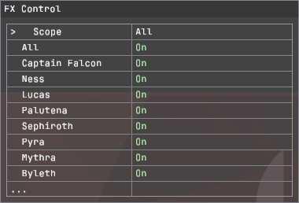

# ssbu-fx-control

> AI-assisted, human-directed and reviewed.

Tested in **Eden** and on an **Erista Switch** without issues observed.
Works with [Switch firmware 23.0.1][firmware], [Atmosphère 1.12.1][atmosphere]
and [Skyline beta `2eb226f`][skyline] (latest checked 2026-10-25).
[Testing and media notes](docs/MEDIA.md)

A one-NRO Skyline plugin for **Super Smash Bros. Ultimate 13.0.5**. Set
character effects **On**, **Off** or **Reduced** for ten fighters, or use
**All**. Changes are visual only: gameplay, hitboxes, camera and RNG stay
untouched ([details](docs/FX.md)).

## On, Off and Reduced

- **On** (the default) shows every effect as the game draws it.
- **Off** removes that fighter's covered effects. Effects already on screen
  finish normally; new ones follow the setting.
- **Reduced** removes part of a covered move's effects and keeps the cue that
  shows what the move does. Each move has numbered variants; variant 1 is the
  default.
- A fighter without a Reduced variant (Inkling) offers On and Off only.
  Reduced never quietly means Off.

## The Deluxe page

With [Online Deluxe](https://git.syntaxbyexample.com/intpa/ssbu-online-deluxe-rewrite)
0.5.3 or later, the plugin has its own page. On Deluxe 0.5.6 or later:

1. Hold **L+R** and tap **D-pad Down** until **FX Control** is shown.
2. Press **Up/Down** to select a row.
3. Hold **ZR** (ZL released) and press **Left/Right** to change it.
4. **All** sets every fighter row. It reads `Unavailable` while the rows
   differ.

The capture uses Scope All; the default is Online. Below the fighter rows,
each move with variants has a row of its own.
[The FX Control page](docs/MENU.md) lists every row and what older Deluxe
versions support.

## Coverage and defaults

- **Fighters:** Captain Falcon, Ness, Lucas, Palutena, Sephiroth, Pyra,
  Mythra, Byleth, Inkling and Kirby. Other fighters' effects are untouched.
- **Defaults:** every row On, Scope Online, variant 1 for each move.
- **Scope:** Online applies the rows only in online play outside Training.
  Set Scope to **All** for offline matches and Training.
- **All = Reduced** sets every fighter with a variant to Reduced and leaves
  the others On.

## Status: 0.2.1, measurement first

0.2.1 is the 0.2.0 code with the plugin SDK pinned to Deluxe 0.5.4. **No
Reduced variant is accepted as a performance improvement yet**, and some
appearance-chosen 0.1.x variants measured slower than On. The operator's
testing report above is not a performance acceptance.
[Moves and variants](docs/FX.md#moves-and-variants) lists each move's
variants; [HARNESS](docs/HARNESS.md) is how one is accepted.

## Install

Download the [0.2.1 NRO and manifest](https://git.syntaxbyexample.com/intpa/ssbu-fx-control/releases/tag/v0.2.1).

1. Copy `libssbu_fx_control.nro` to
   `sd:/atmosphere/contents/01006A800016E000/romfs/skyline/plugins/`.
2. Online Deluxe is optional and only needed for the page. Without it, edit
   `sd:/ultimate/ssbu_fx_control/config.ini`, which is created with the
   defaults on first start; the plugin then detects online play itself
   ([configuration](docs/CONFIGURATION.md)).
3. Do not run it next to Online Deluxe 0.4.x with that version's FX row set
   to Off or Reduced: both would filter the same effects.

## Documents

- [The FX Control page](docs/MENU.md): host versions, controls and every row.
- [Character effects](docs/FX.md): coverage, moves and variants, who owns a
  request, the hooks.
- [Configuration](docs/CONFIGURATION.md): INI, scope and online detection,
  markers, diagnostics and event codes.
- [Measurement harness](docs/HARNESS.md): how a variant is accepted.
- [Media and testing notes](docs/MEDIA.md): image provenance and the operator's
  testing report.
- [Performance method](docs/FX_PERFORMANCE_METHOD.md), the
  [emulator results](docs/FX_EMULATOR_RESULTS.md) and the
  [runtime matrix](docs/FX_RUNTIME_MATRIX.md): records of Online Deluxe
  builds, except the results' quota section, which ran FX Control 0.1.0.
- [Provenance](reference/README.md).

## Build

`tools/Build.ps1` runs `cargo skyline build --release`; `-Package` archives
the NRO, its ELF and a manifest with `tools/package.py`. Host tests:
`cargo test`; lint: `cargo clippy --all-targets -- -D warnings`.

[firmware]: https://en-americas-support.nintendo.com/app/answers/detail/a_id/22525/~/nintendo-switch-system-updates-and-change-history#current
[atmosphere]: https://github.com/Atmosphere-NX/Atmosphere/releases/tag/1.12.1
[skyline]: https://github.com/skyline-dev/skyline/releases/tag/beta
