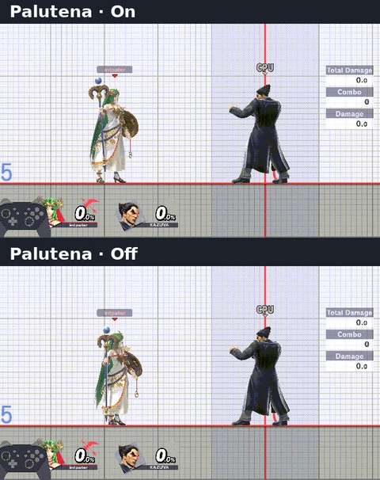

# Fighter effects

FX Control turns down visual effects for ten fighters. Hitboxes, gameplay,
camera and RNG are untouched. Changes apply to new effects at once; effects
already on screen finish normally.

*Off removes the cyan staff glow; the reticle and hits remain. Separate
FX 0.1.0 captures, aligned at the cast. [Capture notes](MEDIA.md#fighter-comparison)*

## Modes

- **On** (default): the game's own effects.
- **Off**: hides that fighter's listed effects.
- **Reduced**: keeps the cue that shows what a move does and drops the
  decoration around it. Offered only where a move has a variant.

## Fighters

Captain Falcon, Ness, Lucas, Palutena, Sephiroth, Pyra, Mythra, Byleth and
Kirby offer On, Off and Reduced. **Inkling** offers On and Off only. Every
other fighter is left alone.

## All

**All** sets every fighter row. All = Reduced leaves a fighter without a
variant (Inkling) On, never Off. While the rows differ, All shows
`Unavailable`.

## Scope

**Online** (default) applies the rows in online play outside Training. Set
**All** for offline matches and Training. With Online Deluxe older than
0.5.0 there is no online signal, so the rows apply only with Scope All
([online detection](CONFIGURATION.md#scope-and-online-detection)). Stage
rows are separate: they ignore Scope and All ([stages](STAGES.md)).

## Moves and variants

Reduced works per move. Each move has numbered variants, lightest first; pick
one on its page row or with `variant.<move>=N` (0 keeps the move original).

- Captain Falcon: Falcon Punch (2)
- Ness: PK Thunder (1), PK Fire (2)
- Lucas: PK Thunder (1)
- Palutena: Explosive Flame (1)
- Sephiroth: Gigaflare (1)
- Pyra: Blazing End (3), Flame Nova (3), Prominence Revolt (2)
- Mythra: specials (1)
- Byleth: specials (1)
- Kirby: Hammer (3)
- Inkling: Roller, no variant

Every variant is a **candidate**: none is accepted yet, and no FPS gain is
claimed. Acceptance follows the [harness](HARNESS.md). What each variant
removes: [variant table](FX_REFERENCE.md#moves-and-variants).

## Who owns a request

An effect follows the fighter that requested it, including that fighter's
projectiles, such as PK Thunder or Explosive Flame. A request no covered
fighter owns passes through untouched.
[Ownership rules](FX_REFERENCE.md#who-owns-a-request)

## Limits

General hit, shield and KO effects stay. A separate article or scripted tint
can remain visible in Off.
[Coverage](FX_REFERENCE.md#coverage) ·
[Differences from Online Deluxe](FX_REFERENCE.md#differences-from-the-peer)

## Testing

- **Current:** on 2026-10-25 the operator reported testing in Eden and on an
  Erista Switch without issues observed. The report names no build or
  scenario and accepts no variant
  ([testing notes](MEDIA.md#operator-reported-testing)).
- **Historical:** earlier runtime evidence was recorded with Online Deluxe
  builds and FX Control 0.1.0
  ([evidence and provenance](FX_REFERENCE.md#evidence-and-provenance)).

## More

[Technical reference](FX_REFERENCE.md) · [Page rows](MENU.md#rows) ·
[INI settings](CONFIGURATION.md) ·
[Performance method](FX_PERFORMANCE_METHOD.md)
