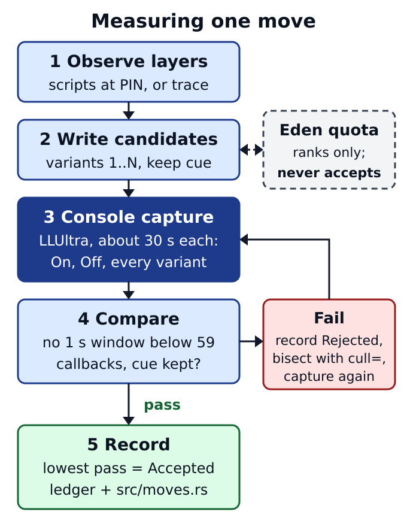

# Measurement harness

Measure each move's numbered Reduced variants on console while keeping its
gameplay cue. Visual simplification alone is not a performance result.
Candidates live in `src/moves.rs`; measurements go in the operator's
`MOVE-LEDGER.md`.

**Status: no Reduced variant is accepted yet.** Every variant is a
`Candidate`.

## The unit: a move with numbered variants

Each move lists its `layers` (parent requests at the pinned script dump) and
numbered cull sets. With the fighter's row on Reduced, `variant.<move>=n`
nulls exactly set *n* (default 1; 0 leaves the move original). Candidates run
from lightest to heaviest; the pick is the lowest-numbered variant that
passes. Fields: [move data](MEASUREMENT_REFERENCE.md#move-data).

## Acceptance rule

| Condition | Requirement |
| --- | --- |
| Device | Console. Eden never accepts |
| Build | Product Online Deluxe build with `CAPTURE_MATCH` |
| Profile | LLUltra, the only profile that drops (Vanilla and LessLag held 60 on every move on 2026-10-15) |
| Scene | Training against a stopped CPU |
| Overlays | Training Modpack Input Display **off**; the Deluxe window **hidden** while the move is performed |
| Capture | Repeat the move for about 30 s, for On, Off and every variant |
| Analysis | `tools/frame_windows.py` in the Deluxe repository |
| **PASS** | **No one-second window below 59 render callbacks** |
| Record | Worst second and frames short of 60, for each condition |

The console is the judge because the LLUltra budget is CPU plus GPU time
inside one vblank. Eden under a CPU quota only ranks candidates.

## Steps per move

The diagram above is the loop; [steps in detail](MEASUREMENT_REFERENCE.md#steps-in-detail)
has the full rules.

1. **Layers:** list the move's `EFFECT*` requests from the scripts at `PIN`;
   if the dump lacks them, run `TRACE_EFFECTS` once and read the log.
2. **Candidates:** decoration first, then bodies; always keep the cue. A
   variant that nulls every layer is Off, and the tests refuse it.
3. **Console passes:** set the row to Reduced and the variant row, then
   capture each condition without leaving Training. Deluxe edits need **ZR
   held** with Left/Right (0.5.3 in Training, 0.5.6 or later everywhere).
   Bisect a close call with `cull=`.
4. **Record:** ledger row per variant; `status` in `moves.rs` follows it;
   Deluxe `docs/VALIDATION.md` entry.
5. **Media:** On / accepted-variant GIF pair, taken in Eden.

## Harness switches

| Switch | Use |
| --- | --- |
| `variant.<move>=N` | Reduced variant per move (0 = original) |
| `cull=<name>,<name>` | Up to 16 extra names nulled under Reduced, for bisection |
| `TRACE_EFFECTS` | Request trace (codes 110, 114, 116). **Keep absent from captures** |
| `TRACE_STAGE_DIAGNOSTICS` | Stage counters (codes 117, 118, 119) |

Markers live in `sd:/ultimate/ssbu_fx_control/`. Details:
[harness switches](MEASUREMENT_REFERENCE.md#harness-switches).

## Stage diagnostics

Create `TRACE_STAGE_DIAGNOSTICS`, then **fully restart Smash**: it is latched
once at stage-hook install. Play the stage On or Off and run
`tools/resolve_trace.py` on `events.log`. Codes 117–119 count hook calls and
request sightings, never rendered frames or FPS, and a missing 119 proves
nothing. Encodings and limits:
[diagnostic event reference](DIAGNOSTICS_REFERENCE.md#stage-diagnostics-117-118-119).

## What this plugin does not measure

Frame times. The capture, per-second counts and API trace are Online
Deluxe's (`CAPTURE_MATCH`, `tools/frame_windows.py`, `api-*.csv`); this
plugin only changes which requests reach the engine and reports which it
saw. Historical emulator method: [performance method](FX_PERFORMANCE_METHOD.md).
