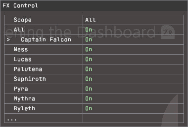

# The FX Control page

The plugin adds two own pages to
[Online Deluxe](https://git.syntaxbyexample.com/intpa/ssbu-online-deluxe-rewrite)'s
window: **FX Control** for fighters and **Stages** for
[stage backgrounds](STAGES.md). Deluxe is optional: both pages edit what
[config.ini](CONFIGURATION.md) holds.

*Captain Falcon On → Off → Reduced → On. 0.2.1 development capture with
Scope All, the capture fixture's setting; the shipped default is Online.
Recorded on released Deluxe 0.7.0
([capture identity](MEDIA_REFERENCE.md#menu-capture-identity)).
[Media notes](MEDIA.md#menu-demo)*

## Editing

1. Hold **L+R** and tap **D-pad Down** until **FX Control** or **Stages** is shown.
2. **Up/Down** selects a row. Group headers are skipped.
3. Hold **ZR**, release **ZL** and press **Left/Right** to change the selected row.
4. Fighter changes apply to new effect requests at once; reload a stage for a
   consistent stage result. Both save to `config.ini`
   ([who writes the file](CONFIGURATION.md#who-writes-the-file)).

Page order, chords and the in-match strip are Deluxe's
([Controls](https://git.syntaxbyexample.com/intpa/ssbu-online-deluxe-rewrite/src/branch/main/docs/CONTROLS.md)).

## Host versions

Both pages use plugin descriptor version 4 (SDK pinned to Deluxe 0.5.4,
`a63bc8c`); FX Control registers first, then Stages.

| Deluxe | Pages | Notes |
| --- | --- | --- |
| Older than 0.5.0, or a legacy SsbuSync host | None | No online signal: Scope Online never applies; stage rows still follow the INI ([details](CONFIGURATION.md#scope-and-online-detection)) |
| 0.5.0 to 0.5.2 | None (version 4 refused) | Online signal; settings follow the INI |
| 0.5.3 or later | Both | Adds the variant rows (plugin API v4) |
| 0.5.6 or later | Both | Values change only while **ZR** is held and **ZL** released, in every scene; a plain Left/Right is ignored |
| 0.6.0 or later | Both | Window Options' OwnPages row can take either page out of the L+R+Down cycle |

## Rows

FX Control has 33 rows, top to bottom:

| Rows | Choices | Notes |
| --- | --- | --- |
| Scope | Online / All | Online: online play outside Training |
| All | On / Off / Reduced | Sets the ten fighter rows; `Unavailable` while they differ. Reduced leaves a row without a variant On ([All](FX.md#all)) |
| 10 fighters | On / Off / Reduced | One per [ledger fighter](FX.md#fighters), in [`fighters::ALL` order](CONFIGURATION_REFERENCE.md#keys). On is green, Reduced yellow. Inkling: On / Off only |
| 9 group headers | — | One per fighter with variants; not selectable |
| 12 move rows | `Original`, `Variant 1` .. `Variant N` | The move's `variant.<move>` value, changed in place. Applies at once while that fighter is Reduced; Original leaves the move untouched |

Moves and variant counts: [Moves and variants](FX.md#moves-and-variants); what
each variant removes: [variant table](FX_REFERENCE.md#moves-and-variants).

## Stages page

**Stages** (`fx_control_stages`) has a **Background visuals** header, **All
backgrounds**, one On / Off row per stage (default On, in the
[stage table](STAGES.md#what-off-hides) order), and a closing **Reload stage to
apply** header. There is no Reduced, and fighter Scope does not apply.

- **All backgrounds** sets all eleven rows and reads `Unavailable` while they
  differ.
- A hook that fails validation makes its rows and **All backgrounds**
  unavailable; the other hook's rows stay usable.
- Rows are `no_persist`, with no host config path; the plugin saves
  `stages=` and `stage.<key>=`.

There is no Stages-page capture.
